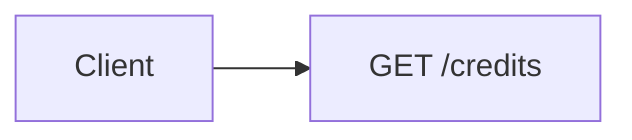

# Work on a Pretty Fish map

Run the commands yourself. Use the CLI path printed by the installer. To find it in a new shell, set:

```bash
PF="${PRETTYFISH_HOME:-${XDG_CACHE_HOME:-$HOME/.cache}/leadgidi/prettyfish}/pf"
```

Set `DOC` to the absolute path of the `.prettyfish.json` file. Quote both paths in commands.

## Create and show a map

For a new map, write a temporary Markdown draft. Use `#` for a page and `##` for a card. Put an optional description before each Mermaid block.

````markdown
# L0: Overview

## Request path

Show what the caller receives.


````

Quote flowchart labels. Use commas instead of semicolons in sequence messages and notes.

Run `"$PF" present "$DOC" --draft "$DRAFT"` with the draft's path. If validation fails, fix the draft and retry the same command. Use `"$PF" present "$DOC"` after editing an existing map. Both forms reuse the viewer when it is open, pack the cards, and check for overlaps and oversized cards. Report the map path and check result.

## Edit an existing file

Write changes to the JSON. Changes made in the browser do not save to disk. Use these commands as needed:

```bash
"$PF" docs list "$DOC"
"$PF" docs set "$DOC" --page "$PAGE" --diagram "$CARD" --code-file "$MERMAID_FILE"
"$PF" docs append "$DOC" --page "$PAGE" --name "$CARD" --code-file "$MERMAID_FILE"
"$PF" docs replace-page "$DOC" --page "$PAGE" --payload-file "$PAGE_FILE"
```

Use `--new-page` instead of `--page` to append to a new page. Put cards in reading order in `pages[].diagrams`. Do not set `x` or `y` by hand.

## Fix a failed check

Fix the reported Mermaid lines in the draft, then retry the same command. If the map already exists, fix the map instead and run `present` without `--draft`. Split cards taller than 1400 px.

Run `"$PF" state` when measurements are missing:

- `no-tab`: Open the watched map and leave the tab open.
- `rendering`: Wait and check state again.
- `stale-app`: Wait for the open tab to apply the new file revision. Do not open another tab to verify a write.
- `error`: Read `reason`, fix the failing diagram, and validate again.

Use `"$PF" watch status` to confirm which file the server is watching. Run `"$PF" watch set "$DOC"` if it is watching the wrong file. Do not report a clean layout without a passing `check` from the open tab.
